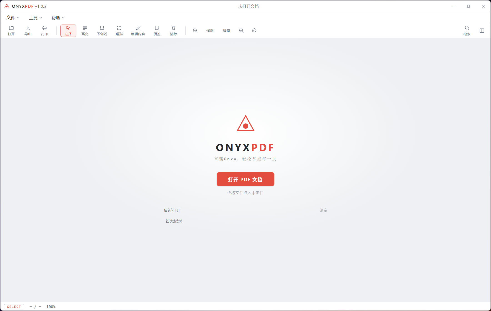

# OnyxPDF

OnyxPDF，国产一站式PDF阅览工具，支持文档编辑、多格式导出，高效处理PDF文档。本地处理，无云端依赖，文档不出本机。

> **English:** OnyxPDF is an all-in-one, offline-first PDF reader and toolkit for Windows. It covers reading, annotation, content editing, page management, and export to DOCX/PPTX/XLSX/images. Everything runs locally on your machine - your documents never leave it.

[下载](#下载) · [参与 Contributing](#参与-contributing) · [开发](#开发)

## 下载

Windows x64 安装包请前往 [GitHub Releases](https://github.com/YOUR_GITHUB_USERNAME/onyx-pdf/releases/latest)。

## 截图（占位）

> TODO: 在 `docs/` 下放置主界面截图（建议 1600x900 PNG），并在此处引用。
> <!--  -->

## 功能

### 阅读核心（PDF.js 引擎）
- 连续滚动、缩放（**Ctrl+滚轮** / 按钮 / 适宽 / 适页）、90° 旋转、翻页
- 文本选择与复制、全文检索（结果列表 + 高亮定位）
- 页面缩略图、书签目录、阅读位置记忆、最近文件
- 拖放打开、命令行/文件关联直开、打印、批量打印

### 批注
- 高亮 / 下划线（真实文本选区）/ 矩形框 / 便签
- 跨会话持久化（localStorage，按文档指纹隔离）
- **保存（Ctrl+S）写回原文件**、另存为（Ctrl+Shift+S）、导出含批注 PDF

### 工具集（基于 pdf-lib 本地实现）
| 工具 | 说明 |
|---|---|
| 合并 PDF | 多选文件按序合并 |
| 拆分 PDF | 每 N 页 / 按页码范围 / 单页拆分，批量写入输出文件夹 |
| 提取页面 | 页码范围（支持 `1-3,5,8-`）导出新 PDF |
| 删除页面 | 删除指定页后另存 |
| 旋转页面 | 指定范围 + 90°/180°/270° |
| 插入空白页 | 指定位置/方向/尺寸（同相邻页或 A4） |
| 文本水印 | 中文水印（画布渲染嵌入）、平铺 45° / 居中、透明度可调 |
| 添加页码 | 4 种位置、3 种格式、自定义起始编号 |
| 图片转 PDF | 多选 PNG/JPG，按原图尺寸成页 |
| 清理优化 | 移除元数据、重建文档结构 |
| 新建 PDF | 空白文档（菜单） / 从图片创建 |

### V3 新增
- **多标签页**：同时打开多个 PDF，标签切换（Ctrl+Tab 循环），阅读位置独立记忆
- **导出格式扩展**：Word（.doc）、Excel（.csv）、图片（PNG/JPG 当前页 + 全部页面批量导出到文件夹）
- **页面顺序调整**：侧栏缩略图拖拽排序 → 应用生成新文档
- **插入图片页**：图片作为整页插入当前文档
- **文本框标注**：点击页面插入文字（支持中文、字号、颜色、加粗、拖动定位），随批注一起导出/保存

### 菜单栏
文件（打开/新建/最近文件/保存/另存为/导出 PDF 为/打印/批量打印/关于/退出）· 工具 · 帮助

## 快捷键

| 键 | 功能 |
|---|---|
| Ctrl+O / Ctrl+F / Ctrl+P | 打开 / 检索 / 打印 |
| Ctrl+S / Ctrl+Shift+S / Ctrl+Q | 保存 / 另存为 / 退出 |
| Ctrl+滚轮 | 以光标附近为锚点缩放 |
| Ctrl+= / Ctrl+- / Ctrl+0 | 放大 / 缩小 / 适宽 |
| ← → / PgUp PgDn / Home End | 翻页 |
| V H U R N / S / W | 切换工具 / 侧栏 / 适宽 |

## 开发

```bash
npm install
npm start            # 启动应用
npm run dist
```

工程结构：`src/main`（主进程 IPC）· `src/renderer`（UI 与阅览、批注、检索、工具模块）。

构建与打包详见 [BUILD.md](BUILD.md)。Windows 安装包：`dist_out/OnyxPDF Setup 1.0.2.exe`（NSIS，含桌面/开始菜单快捷方式与卸载器）。

## 参与 Contributing

欢迎通过 Issue 反馈问题、提交 Pull Request。贡献流程与环境要求见 [CONTRIBUTING.md](CONTRIBUTING.md)。

## 许可

MIT
